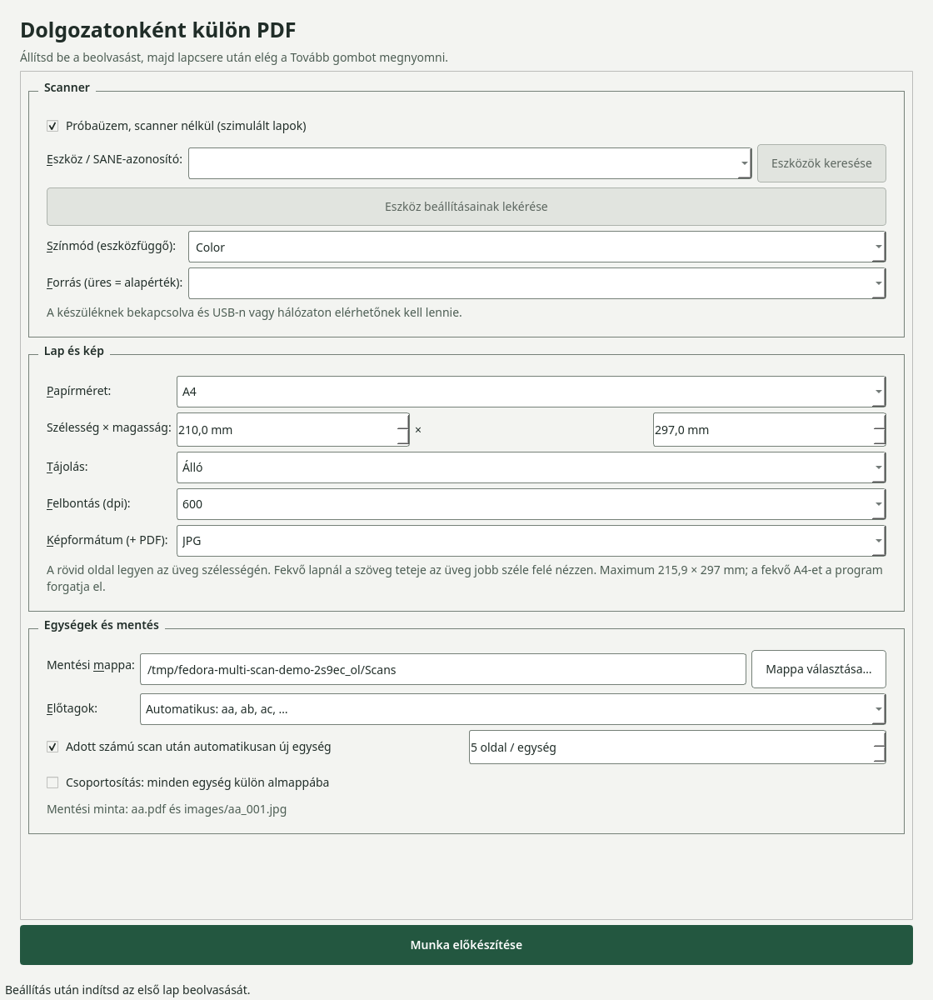
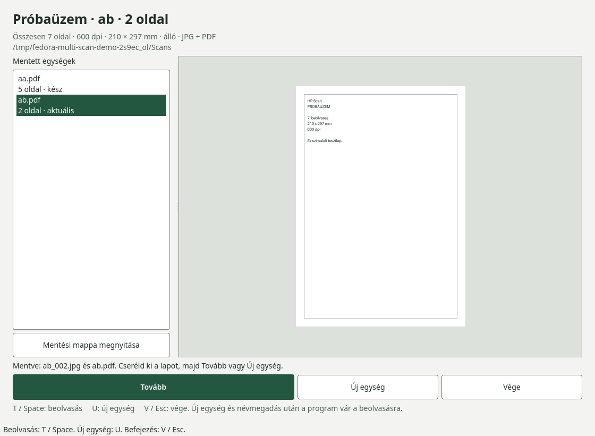
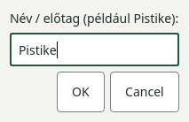

# Fedora Multi Scan

A desktop scanning app for turning a stack of related documents into separate
PDFs without repeatedly starting and stopping a scanning session. Designed for
manual page changes on an **HP LaserJet Pro MFP M130nw**, with a Hungarian UI.

For example, scan one student's test as `aa.pdf` and `aa_001.jpg`,
`aa_002.jpg`, then press **U** to prepare the next student's `ab` group.
You can use names such as `Pistike` and `Petike` instead of automatic prefixes.

**Status:** the application, simulated scans, SANE test backend and portable
packaging are tested on Fedora 44 x86_64. The AppImage's output smoke test and
headless GUI startup also run in a Fedora 45 container. Testing with a
powered-on M130nw and on a Fedora 45 desktop is still pending.
This is a community project, not an HP product.

## Screenshots

Screenshots of the running application in demo mode. Pages are explicitly
marked synthetic; no student documents are shown.







## Features

- A4, A5, A6, ISO/JIS B5, Letter and custom scan areas up to 215.9 × 297 mm.
- Portrait or landscape output; landscape rotates the captured image 90° left.
- Configurable resolution, defaulting to **600 dpi**.
- A numbered JPG or PNG for each page, plus one PDF per document group.
- Automatic prefixes starting at `aa`, or a custom name for every group.
- Optional fixed group size, such as five scans per student's test.
- Separate `images/` directory, or one subdirectory per group containing both
  its PDF and images.
- Keyboard controls and an immediately focused custom-name dialog.
- PDF updates after every page, session recovery and file collision checks.
- A scanner-free demo mode that writes real output files using synthetic pages.

**Every scan requires an explicit action.** Preparing a session, starting a new
group or accepting a name with Enter never starts scanning.

## Run on Fedora

Install scanner drivers on the machine connected to the scanner:

```bash
sudo dnf install sane-backends sane-airscan hplip hplip-libs
```

Download an x86_64 portable package from [Releases](https://github.com/huser123/Fedora-multi-scan/releases)
when available, or build it using the instructions below. The application
includes its Python, Qt and image/PDF dependencies; SANE and HP drivers are
system dependencies. The desktop's fontconfig library and configuration are
used for fonts. No proprietary HP plug-in is bundled.

```bash
chmod +x FedoraMultiScan-1.0.0-x86_64.AppImage
./FedoraMultiScan-1.0.0-x86_64.AppImage
```

If FUSE mounting is unavailable, use:

```bash
APPIMAGE_EXTRACT_AND_RUN=1 ./FedoraMultiScan-1.0.0-x86_64.AppImage
```

The portable tar archive works without FUSE:

```bash
tar -xzf FedoraMultiScan-1.0.0-x86_64.tar.gz
./FedoraMultiScan-1.0.0.AppDir/AppRun
```

Use `--demo` to try the application without a scanner. Choose a separate output
folder because demo mode writes files just like a real scanning session.

If HPLIP reports a missing proprietary component, run `hp-plugin -i` on the
target machine and review HP's license. See the [HP plug-in documentation](https://developers.hp.com/hp-linux-imaging-and-printing/binary_plugin.html).

## Workflow and shortcuts

Choose the device, page size, orientation, resolution, output format and folder.
Click **Munka előkészítése** to prepare the session. Place a page on the glass,
then use the controls below.

| Action | UI label | Keys |
| --- | --- | --- |
| Scan one page | Tovább | **Space**, **T**, Ctrl+Enter |
| Prepare a new group, without scanning | Új egység | **U**, Ctrl+N |
| Finish the session | Vége | **V**, **Esc**, Ctrl+Q |
| Accept a group name | Dialog OK | Enter |
| Cancel name entry | Dialog Cancel | Esc |

The name dialog receives focus immediately. Letters and spaces type into the
name field normally; scanning shortcuts are inactive while the dialog is open.
After accepting a name, put the page on the glass and press Space separately.
This also applies when fixed-size grouping requests the next name.

The M130nw has a flatbed rather than an automatic document feeder, so pages
must be changed manually. Fixed-size grouping counts completed scans; it does
not feed or scan pages automatically. A final group with fewer pages is saved.

## Output layout

Default:

```text
output/
├── aa.pdf
├── ab.pdf
└── images/
    ├── aa_001.jpg
    ├── aa_002.jpg
    └── ab_001.jpg
```

With group folders enabled:

```text
output/
├── Pistike/
│   ├── Pistike.pdf
│   ├── Pistike_001.png
│   └── Pistike_002.png
└── Petike/
    ├── Petike.pdf
    └── Petike_001.png
```

A hidden `.hpscan/` directory stores session journals. Keep it to resume an
unfinished session. Closing the window leaves a resumable session; **Vége**
marks it finished. Selecting the same folder offers to resume the latest
unfinished session with its original settings. Existing prefixes are skipped
for automatic naming and rejected for custom naming.

Images are committed before the corresponding PDF update. If a PDF update
fails, the saved images can rebuild it on recovery. Errors preserve available
raw scan data and report its location. This is not a substitute for backups.

## Page placement

Place the **short edge across the width of the glass**, including for landscape
A4. For landscape output, the top of the printed text must point toward the
**right edge of the scanner glass**. The app rotates the captured page 90° left.
It does not detect text orientation. Custom dimensions describe the capture
area before rotation. A3 and areas larger than the flatbed are not supported.

## Develop and test

Python 3.11 or later is required for source execution. Builds have been made
with Python 3.14 on Fedora 44.

```bash
python3 -m venv .venv
.venv/bin/python -m pip install -e . pytest pytest-qt pyinstaller
.venv/bin/python -m hpscan --demo
QT_QPA_PLATFORM=offscreen .venv/bin/python -m pytest -q
```

For GUI tests with a virtual X server, install `xorg-x11-server-Xvfb`, then run
`xvfb-run -a .venv/bin/python -m pytest -q`. Scanner integration tests use SANE's
software `test` backend and skip when `scanimage` is absent.

Headless output smoke test (use a fresh folder):

```bash
.venv/bin/python -m hpscan --smoke-test /tmp/multi-scan-smoke
```

See [the verification record](docs/VERIFICATION.md) for coverage and remaining
hardware checks, or the [Hungarian user guide](docs/HASZNALAT.md).

## Build portable packages

On Fedora x86_64, install `python3`, `python3-pip`, `binutils`, `curl`, `tar`,
`gzip`, `file` and `desktop-file-utils`, then create the development environment
above. The build downloads a checksum-verified official `appimagetool` release.

```bash
bash tools/build-portable.sh
```

The resulting `dist/` contains the AppImage, portable tar archive, checksums
and Hungarian instructions. Build details and third-party licenses are included
inside both packages. Keep portable directories on a filesystem that supports
symbolic links; transfer the tar.gz archive intact and extract it on Linux.
For the dependency versions used in the initial build, install
`requirements-build.txt` before installing the project with `--no-deps`.

The binaries target Fedora x86_64. Compatibility with other distributions or
architectures is not claimed. A build made on a newer glibc distribution may
not work on an older one. See [PyInstaller's portability notes](https://pyinstaller.org/en/stable/common-issues-and-pitfalls.html).

For a new release, update the versions in `hpscan/__init__.py` and
`pyproject.toml`, update `CHANGELOG.md`, and add `docs/RELEASE-vX.Y.Z.md`.
Push an annotated `vX.Y.Z` tag after testing. The release workflow checks the
tag against the app version, builds and tests the portable packages, and
uploads them to the matching GitHub Release.

## Hardware check before use

1. Run `scanimage -L` and confirm that SANE sees the connected scanner.
2. In the app, search for devices and load the selected device's options.
3. Scan a test page at 300 and 600 dpi, including landscape output.
4. Check full-page coverage, image dimensions, PDF size and page order.
5. Try two groups, fixed-size grouping, cancel and resume before scanning
   documents you intend to keep.

Backends expose different resolutions, color modes and sources. Unsupported
settings produce an error. The scanner command uses SANE's
[`scanimage`](https://www.sane-project.org/man/scanimage.1.html).

## License

[MIT](LICENSE) for application source. See [third-party notices](THIRD_PARTY.md)
for bundled libraries and the unmodified KDE Breeze scanner icon.
